<div align="center">


# AAOS — Academic AI OS

**A local-first academic assistant for university Moodle.**
It syncs your courses read-only, answers questions from your own course files with citations,
keeps your study tasks, and tells you on Telegram when something changes.
By default everything runs on your machine; an optional Gemini cloud model can be switched on from the app. The AI model proposes; trusted code decides.

<a href="docs/media/aaos-demo.mp4"></a>

**▶ [Watch the full 51-second demo with sound](docs/media/aaos-demo.mp4)** — real recordings of AAOS, with voiceover.

</div>

---

## Contents

- [What AAOS does](#what-aaos-does)
- [See it working](#see-it-working)
- [Design principles](#design-principles)
- [Architecture](#architecture)
- [How a question is answered](#how-a-question-is-answered)
- [Moodle sync and notifications](#moodle-sync-and-notifications)
- [Human approval for external actions](#human-approval-for-external-actions)
- [The phases: how AAOS was built](#the-phases-how-aaos-was-built)
- [Technology](#technology)
- [Quality and evidence](#quality-and-evidence)
- [Getting started](#getting-started)
- [Project structure](#project-structure)
- [Limitations](#limitations)
- [Development status](#development-status)
- [Documentation](#documentation)

---

## What AAOS does

| | |
|---|---|
| **Moodle, read-only** | Signs in through your own browser profile and syncs courses, assignments, deadlines, announcements and files. AAOS never submits, posts or changes anything on Moodle. |
| **Ask AAOS** | Ask in English or Arabic: *"What's due this week?"*, *"What is KNIME based on my past courses?"*, *"شو يعني overfitting"*. Answers come from your course files and Moodle data, with sources, or AAOS says it doesn't have enough evidence. |
| **Grounded answers** | Every claim in a document answer must cite a passage. A local NLI model checks that the passage actually supports the claim; unsupported claims are dropped rather than shown. |
| **Study tasks and plans** | *"Add a study task: review chapter 2 for Natural Language Processing"* creates a local task, linked to its course. AAOS can also plan your study week from real deadlines. |
| **Calendar with approval** | AAOS can propose a Google Calendar event. Nothing is created until you approve it, from the proposal, the Approvals page or the Tasks page, and every approval is recorded. |
| **Moodle change alerts** | A scheduled check compares Moodle snapshots and sends Telegram messages for new assignments, deadline changes, new files and announcements. |
| **Dashboard** | A Next.js dashboard for courses, deadlines, documents (with an in-page PDF viewer), tasks with color-coded priority, approvals, activity and system health, in English or Arabic, in a light or dark theme. When you answer with your ChatGPT plan, the model panel shows how much AAOS has used. |
| **Past courses** | Archived semesters stay searchable and are clearly labelled as past. |

## See it working

Real screens from a running AAOS connected to a real Moodle account. Most were captured with the
optional Gemini model selected, which is why their top bar shows the cloud badge; the default is the
local model, and the badge then reads `Local · …`, as on the newer screens (Tasks, dark theme,
Arabic and the model panel).

| | |
|---|---|
| 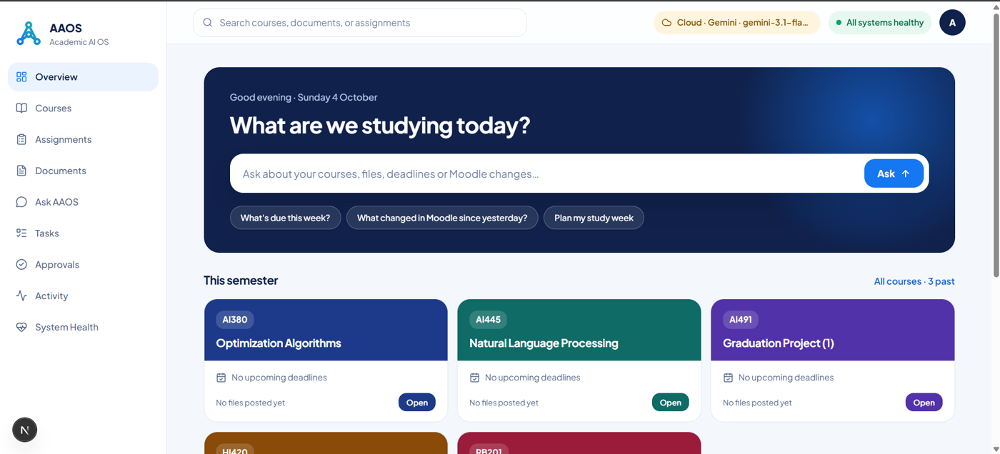<br>**Overview.** The semester's courses at a glance, with one place to ask. | 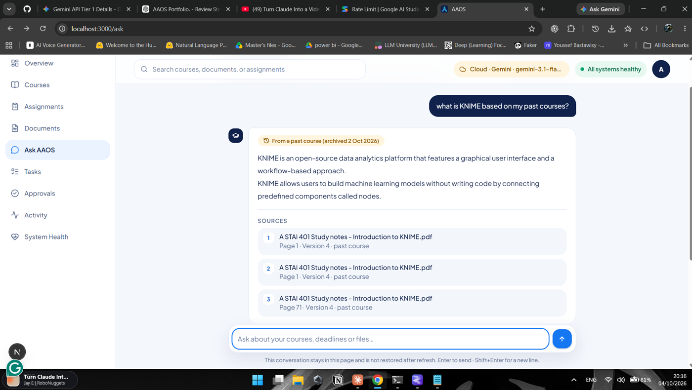<br>**Answers from your own files.** The reply says it comes from a past course and lists the file and page of every source. |
| 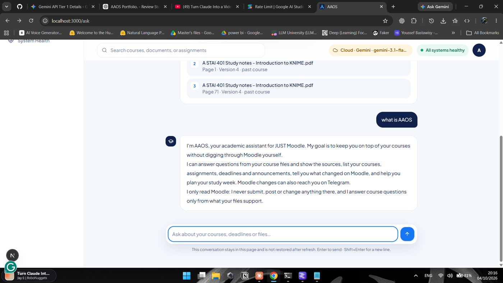<br>**It knows its limits.** Questions about AAOS itself get a fixed answer; it only reads Moodle. | 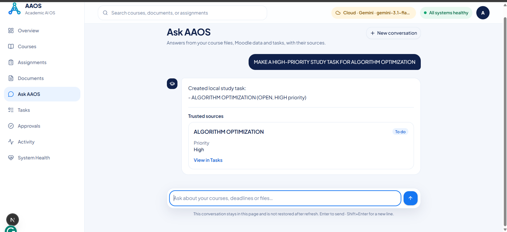<br>**Tasks from a sentence.** "Make a high-priority study task…" creates a local task, kept in AAOS only. |
| 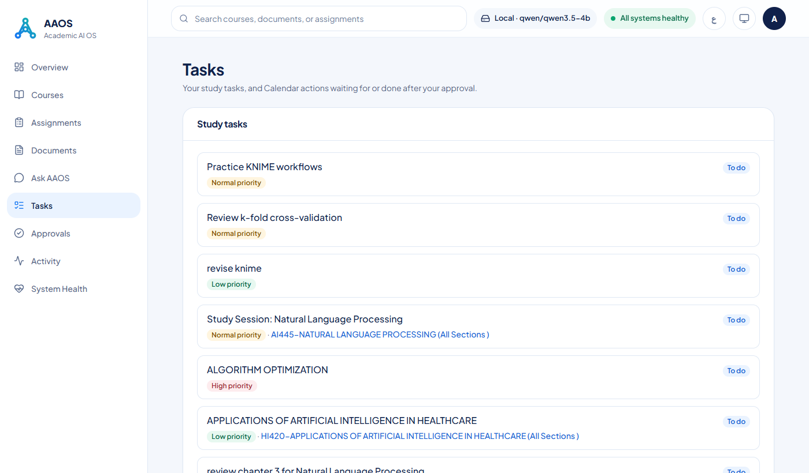<br>**Tasks page.** Study tasks with status, a priority badge (red for high, amber for normal, green for low) and the course they belong to. Calendar actions waiting for you get **Approve** and **Reject** buttons here too. | 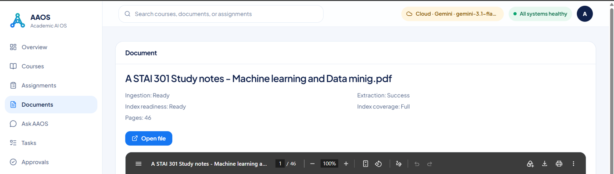<br>**Open any file.** Ingestion and index status, and the original PDF in the built-in viewer. |
| 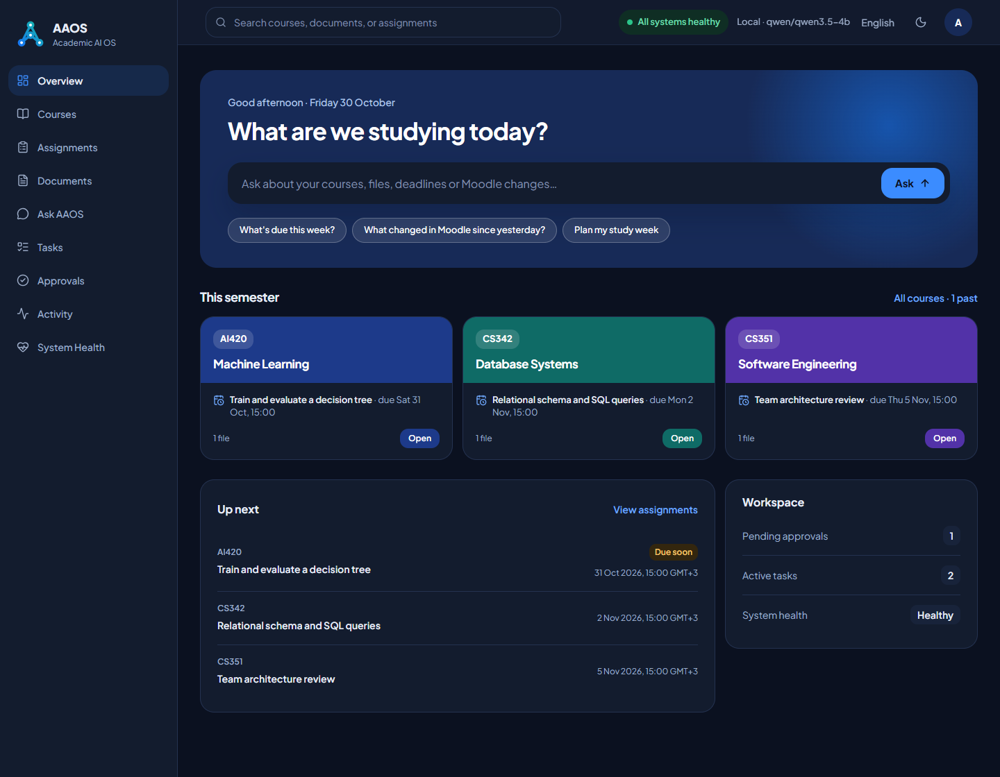<br>**Dark theme.** Light, Dark or System, picked from the theme menu in the top bar and remembered in the browser. | 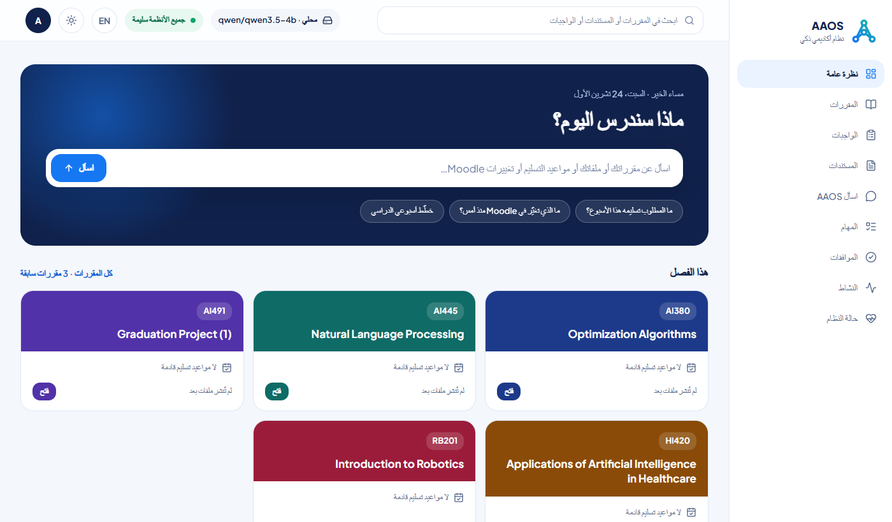<br>**Arabic.** The whole interface in Arabic, laid out right to left. Course names and other Moodle content are shown as Moodle sends them. |
| 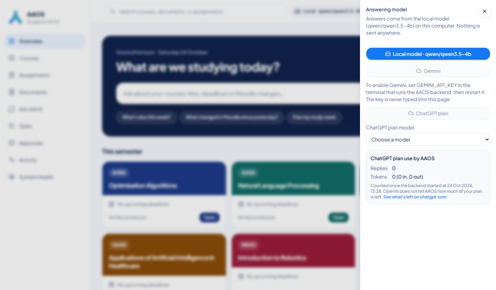<br>**ChatGPT plan use.** Replies and tokens AAOS has used since the backend started. OpenAI doesn't report what's left on your plan, so the panel links to OpenAI's usage page and warns when the limit is reached. | |

## Design principles

1. **Local-first.** The database, documents, search index and models run on your machine. The only outside calls are Moodle itself, Telegram and Google Calendar when you turn them on, and Google's Gemini API if you opt in to the cloud model (off by default, confirmed in the app before anything is sent).
2. **The model has no authority.** The local LLM only *proposes* a structured action. Trusted code validates its arguments against a schema, checks permissions and runs it. Model output, retrieved text and tool results are treated as untrusted input.
3. **Read-only toward Moodle.** Synchronization reads; it never writes.
4. **Grounded or nothing.** An answer cites its evidence, or AAOS says it cannot answer. It does not invent deadlines, files or facts.
5. **Humans approve external writes.** Writes outside AAOS (like a Calendar event) go through a durable approval record. Unclear outcomes are shown as unknown, never as success.
6. **Secrets stay out of reach.** Credentials, cookies and tokens are never logged, never sent to the frontend, never placed in model context, and never committed.
7. **Built in gated phases.** Each phase has a written acceptance gate. A phase is frozen with a git tag only after human acceptance.

## Architecture

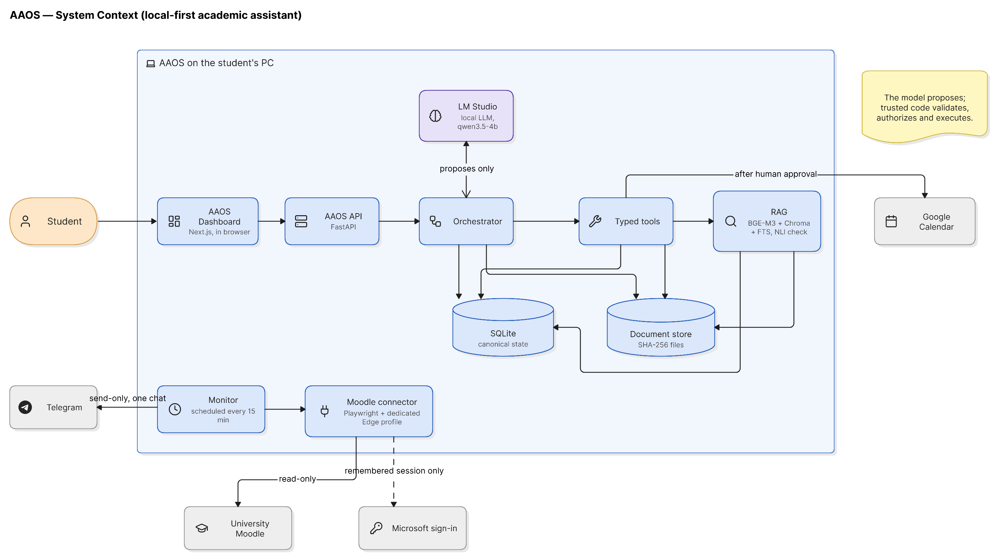

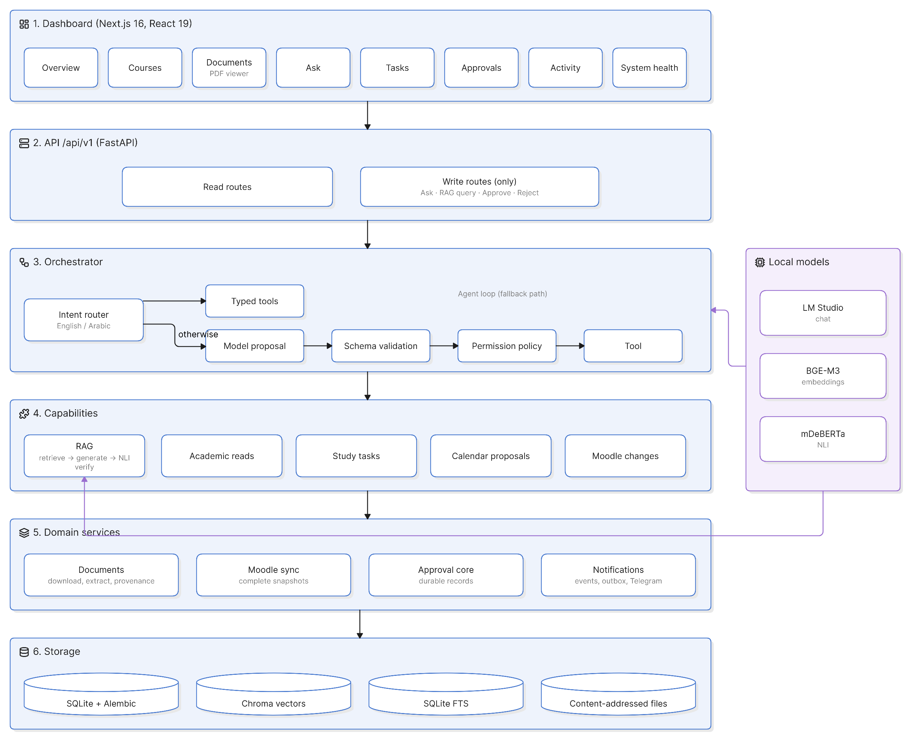

AAOS is one Python backend, a Next.js dashboard and a local model server:

| Layer | What it does | Where |
|---|---|---|
| **Dashboard** | Next.js 16 / React 19 app. Talks only to the AAOS API (same origin). | `frontend/` |
| **API** | FastAPI, versioned under `/api/v1`. Read routes plus a closed set of writes: Ask, RAG query, approve, reject. | `src/aaos/web/` |
| **Orchestrator** | Routes each question. Known question types (deadlines, courses, changes, documents) go straight to typed tools; anything else goes to a bounded agent loop where the model proposes tool calls. | `src/aaos/agent/` |
| **Typed tools** | Narrow, schema-validated operations: list courses, read assignments, search documents, create a study task, propose a Calendar event. | `src/aaos/agent/` |
| **RAG** | Hybrid retrieval (BGE-M3 dense vectors in Chroma + SQLite FTS lexical search), grounded generation, and NLI claim verification. | `src/aaos/rag/` |
| **Documents** | Downloads Moodle files into a content-addressed store (SHA-256), extracts PDF and Word text (including Arabic), keeps page-level provenance. | `src/aaos/documents/` |
| **Moodle connector** | Browser-based, read-only sync using a dedicated Edge profile; produces complete snapshots or fails closed. | `src/aaos/moodle/` |
| **Approvals and tasks** | Durable approval records, idempotent execution, reconciliation and honest `UNKNOWN_OUTCOME`. | `src/aaos/approval/`, `src/aaos/tasks/` |
| **Notifications** | Snapshot diff into events, outbox with de-duplication and retry, send-only Telegram adapter. | `src/aaos/notifications/` |
| **Persistence** | SQLite with Alembic migrations as the single source of workflow and academic state. | `src/aaos/persistence/`, `migrations/` |
| **Local models** | LM Studio serves the chat model (`qwen/qwen3.5-4b`); embeddings (BGE-M3) and NLI (mDeBERTa) run in-process. | `src/aaos/inference/` |

## How a question is answered

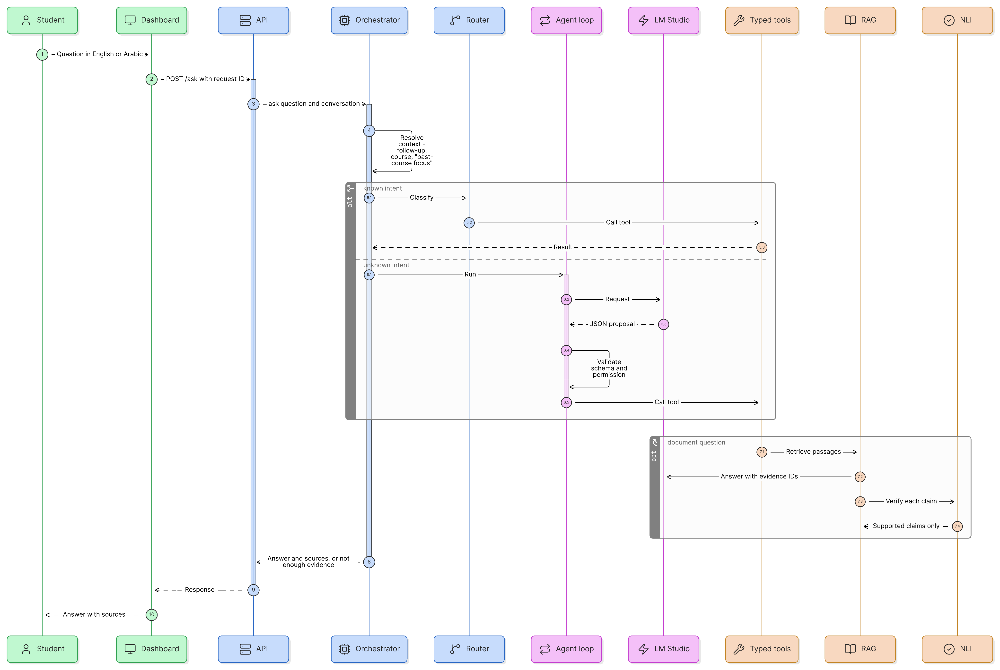

1. The dashboard sends the question to `POST /api/v1/ask`.
2. The orchestrator checks the conversation context: follow-ups, a course named in an earlier turn, a past-course focus.
3. A deterministic router recognises common intents in English and Arabic. These call typed tools directly, so a known question needs no model guess.
4. Anything else enters the agent loop. The model returns a JSON proposal, which is checked against a closed schema before any tool runs.
5. Document questions go to RAG: retrieve passages, generate an answer whose claims cite evidence IDs, verify each claim with NLI, and keep only supported claims.
6. The answer returns with its sources, or as *not enough evidence*. Writes (a study task, a Calendar proposal) are only possible when the request carries a request ID, which makes retries idempotent.

## Moodle sync and notifications

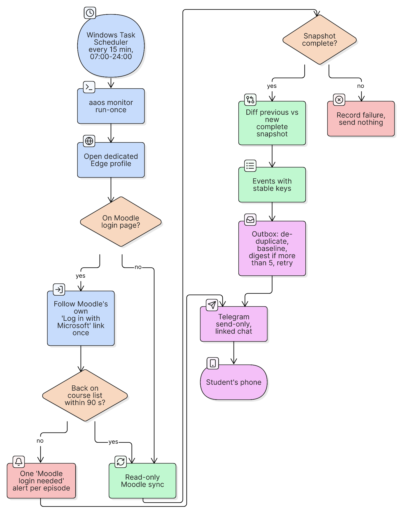

- `aaos monitor run-once` runs every 15 minutes (Windows Task Scheduler), 07:00–24:00.
- It opens the dedicated Edge profile, follows Moodle's own *Log in with Microsoft* link if the session has ended, and syncs. AAOS never types into, clicks or reads any sign-in page.
- A sync is only used when it is **complete**. Two complete snapshots are compared, and each meaningful change becomes an event with a stable key, so it is sent exactly once.
- Events go through an outbox: a baseline when you enable notifications, a digest when there are many changes, and retry with backoff.
- The Telegram adapter is send-only, to one linked chat. Its token is stored outside the repository and never logged.

## Human approval for external actions

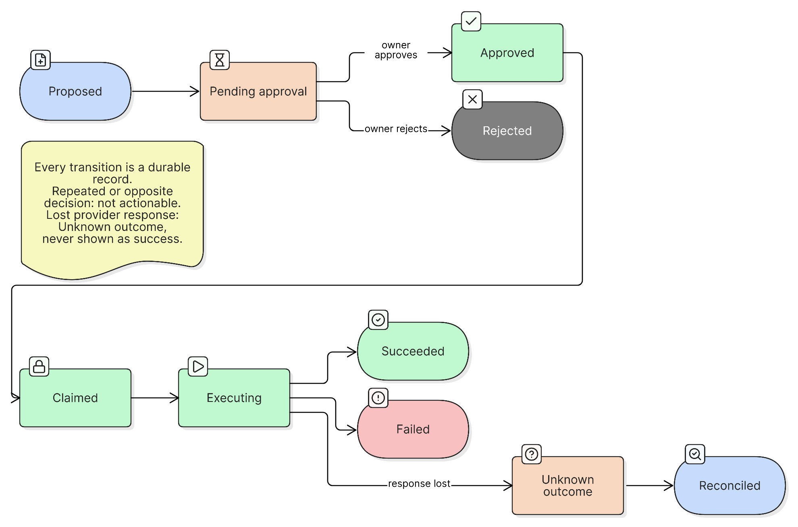

A Calendar event goes through: **proposal → approval → claim → execution → reconciliation**. Each step is recorded durably. A repeated or opposite decision is rejected. If the provider's response is lost, the task shows `UNKNOWN_OUTCOME` instead of pretending it succeeded.

## The phases: how AAOS was built

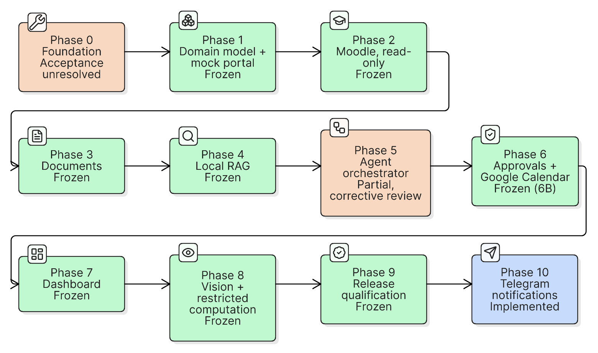

AAOS was built strictly phase by phase. The full roadmap and gates are in [`docs/PHASES.md`](docs/PHASES.md); acceptance decisions are in [`docs/GOVERNANCE_LEDGER.md`](docs/GOVERNANCE_LEDGER.md).

| Phase | What it built |
|---|---|
| **0 — Foundation** | Reproducible environment, `aaos doctor` diagnostics, LM Studio connectivity, security baseline. |
| **1 — Domain model** | Normalized academic models (courses, assignments, files, announcements) and a deterministic mock portal, before touching the real university system. |
| **2 — Moodle, read-only** | Real authentication through the user's own browser and read-only synchronization into complete snapshots. |
| **3 — Documents** | Safe file download, a content-addressed store, PDF/Word extraction with page provenance. |
| **4 — Local RAG** | Hybrid retrieval, citation-grounded generation, NLI claim verification, and an honest *insufficient evidence* result. |
| **5 — Agent orchestrator** | The controlled agent loop with typed tools, schema validation, permission policy and evaluation harnesses. |
| **6 — Approvals and Calendar** | Durable approval core (6A) and the first gated external write, Google Calendar (6B). |
| **7 — Dashboard** | Browser API and the dashboard: academic views, Ask AAOS, tasks and approvals, activity and system health. |
| **8 — Vision and computation** | Visual document understanding with provenance, and OS-isolated restricted computation. |
| **9 — Release qualification** | Clean setup, failure-recovery matrix, privacy audit, evaluation and portfolio evidence. |
| **10 — Notifications** | Moodle change detection and Telegram alerts, scheduled monitoring, and automatic continuation of a remembered Microsoft sign-in. |

## Technology

| Area | Stack |
|---|---|
| Backend | Python 3.11, FastAPI, SQLAlchemy 2, Alembic, SQLite, uv |
| Moodle | Playwright with Microsoft Edge (visible, dedicated profile) |
| Retrieval | BGE-M3 (FlagEmbedding), Chroma, SQLite FTS5 |
| Generation | LM Studio, `qwen/qwen3.5-4b` |
| Verification | mDeBERTa NLI (Transformers, PyTorch) |
| Documents | pypdfium2, python-docx |
| Frontend | Next.js 16, React 19, TypeScript, Tailwind CSS 4, TanStack Query, shadcn/Radix |
| Integrations | Google Calendar API (approval-gated), Telegram Bot API (send-only) |
| Quality | pytest, Vitest, Testing Library, ruff, mypy, ESLint |

## Quality and evidence

- **Tests:** about 4,250 backend tests and 264 frontend tests (October 2026), run before every merge.
- **Boundary tests** pin the exact API route list, the closed set of write routes, import-time inertness, and the absence of secrets in logs and responses.
- **Evaluations** live in [`docs/evaluations/`](docs/evaluations/): Arabic retrieval, RAG refusal traces, coverage stability, a reranker spike and Ask latency.
- **Release evidence** for Phase 9 is in [`docs/release/`](docs/release/): clean setup, failure recovery, privacy audit and claim scope.
- **Debugging discipline:** non-trivial fixes go through *failure → evidence → hypotheses → discriminating experiment → root cause → regression test*.

## Getting started

> AAOS targets **Windows 11** with an NVIDIA GPU (developed on 6 GB VRAM). It is a personal, local system, not a hosted service.

**Prerequisites:** Python 3.11, [uv](https://docs.astral.sh/uv/), Node.js (LTS), Microsoft Edge, and [LM Studio](https://lmstudio.ai/) with `qwen/qwen3.5-4b` loaded and its local server running.

```powershell
# 1. Install
git clone <this repository> aaos
cd aaos
uv sync
cd frontend; npm ci; cd ..

# 2. Create a data folder outside the repository and the database
mkdir ..\aaos-data
cd ..\aaos-data
..\aaos\.venv\Scripts\python.exe -m alembic -c ..\aaos\alembic.ini upgrade head

# 3. Check the environment
..\aaos\.venv\Scripts\aaos.exe doctor
```

**Run.** One command starts the backend and the dashboard, each in its own window, waits until
both answer and opens <http://localhost:3000>:

```powershell
.\scripts\start-aaos.ps1
```

Or double-click `scripts\start-aaos.cmd`, which you can also pin to the desktop or taskbar. The
script looks for the data folder in `AAOS_DATA_DIR`, else an `aaos-data` folder next to the
repository (or pass `-DataDir <path>`), and `-NoBrowser` skips opening the browser. A server
that is already running is left alone. To stop AAOS, close the `AAOS backend` and
`AAOS dashboard` windows. With the default local model, LM Studio must be running; the script warns
if it isn't. The server windows inherit the environment of the terminal that ran the script, so to
use a cloud model, set its variables there first (a double-click always starts on the local model).

Or start the two servers yourself (two terminals):

```powershell
# Backend, from the data folder
cd aaos-data
$env:PYTHONUTF8 = '1'
..\aaos\.venv\Scripts\python.exe -m uvicorn aaos.main:app --host 127.0.0.1 --port 8000
```

```powershell
# Dashboard
cd aaos\frontend
npm run dev
```

Open <http://localhost:3000>.

**Optional: answer with a Gemini model instead of the local one.** This is off by default and
changes the privacy model: your questions and the excerpts of your course files used to answer them
are sent to Google. Embeddings and the claim checker still run locally. Set these in the backend's
terminal before starting it (the key lives only in that terminal's environment, never in a file):

```powershell
$env:AAOS_MODEL_PROVIDER = 'gemini'
$env:AAOS_GEMINI_MODEL   = '<model name from Google AI Studio>'
$env:GEMINI_API_KEY      = '<your key>'
```

The backend logs `CLOUD MODEL ACTIVE` at startup. Open a new terminal, or remove the variables, to
return to the local model.

You can also start on the local model and switch from the page. Set only `AAOS_GEMINI_MODEL` and
`GEMINI_API_KEY` before starting the backend: a badge in the top bar always shows which model is
answering (`Local · …` or `Cloud · Gemini · …`), and clicking it opens a panel to switch. Going to
Gemini asks for an explicit confirmation first, a switch is refused while a question is running, and
the choice resets to the local model whenever the backend restarts. The page never asks for the key.

Free Gemini keys have low request limits (a few requests per minute for the newest models), and one
question about your files makes several model calls. AAOS waits out a per-minute limit for as long as
Google asks (never on a daily limit, and never more than 30 s at a time) and retries a short
"high demand" error. To avoid hitting the limit at all, set `AAOS_GEMINI_MIN_INTERVAL_SECONDS` (for
example `7`) to leave that many seconds between requests; the default is no spacing, which suits a paid
key. `scripts/gemini_probe.py` sends one request per format AAOS uses and reports each in safe words.

**Optional: answer with your ChatGPT plan (Phase 11).** Also off by default, and the same privacy
change, with OpenAI instead of Google: your questions and the course excerpts used to answer them
are sent to OpenAI, and the usage counts against your ChatGPT Plus or Pro plan through OpenAI's
**Sign in with ChatGPT**. It is a plain model call, not the Codex CLI: no tools, and only AAOS's own
prompt. Sign in once, in a terminal (never in the page):

```powershell
..\aaos\.venv\Scripts\aaos.exe model chatgpt-plan sign-in
```

Your browser opens an OpenAI page. Allow AAOS to use your plan, and the sign-in is saved in an
owner-only file outside the repository (`%LOCALAPPDATA%\AAOS\credentials\chatgpt-plan.json`; set
`AAOS_CHATGPT_PLAN_CREDENTIAL_PATH` to move it). `aaos model chatgpt-plan status` shows the state
without contacting OpenAI, and `aaos model chatgpt-plan sign-out` revokes and removes the tokens.
Then pick **ChatGPT plan** and a model in the model panel (it asks for confirmation, also when you
come from Gemini), or start the backend with `AAOS_MODEL_PROVIDER=chatgpt_plan` and
`AAOS_CHATGPT_PLAN_MODEL=<model>`. Set a weekly limit for AAOS at
<https://chatgpt.com/settings/usage>; when the plan limit is reached, AAOS stops and says so, and
OpenAI never moves the request to paid billing. The model panel counts the replies and tokens AAOS
has used since the backend started; OpenAI doesn't tell AAOS how much of the plan is left, so the
panel links to the usage page for that. The preview ignores `temperature`, so answers can
differ slightly from run to run. `scripts/chatgpt_plan_probe.py` reports, in safe words, which
request shapes your plan accepts.

**Connect Moodle and index your files** (from the data folder):

```powershell
..\aaos\.venv\Scripts\aaos.exe moodle bootstrap     # one-time, human-controlled: you sign in yourself
..\aaos\.venv\Scripts\aaos.exe moodle browser-auth  # one-time: provision the dedicated Edge profile
..\aaos\.venv\Scripts\aaos.exe moodle sync          # read-only sync
..\aaos\.venv\Scripts\aaos.exe documents ingest-new
..\aaos\.venv\Scripts\aaos.exe rag index-new
```

**Telegram alerts** are optional; see [`docs/NOTIFICATIONS.md`](docs/NOTIFICATIONS.md).

**Optional: Calendar proposals with your approval (Phase 12).** Off by default. When it's on, Ask
AAOS can propose a Google Calendar event, and the event is written only after you click **Approve**
on the proposal, the Approvals page or the Tasks page. Reject writes nothing, and a proposal you don't decide
within 24 hours expires. Events go to a **dedicated calendar** shared with AAOS's Google service
account ("Make changes to events"), never to your primary calendar. Set these in the backend's
terminal before starting it:

```powershell
$env:AAOS_CALENDAR_PROPOSALS        = 'on'
$env:AAOS_LOCAL_APPROVER_IDENTITY   = 'owner'
$env:AAOS_LOCAL_APPROVER_CONTEXT_ID = 'aaos-laptop-1'
$env:AAOS_GOOGLE_CALENDAR_ID        = '<the dedicated calendar ID, ending in @group.calendar.google.com>'
$env:AAOS_GOOGLE_SERVICE_IDENTITY   = '<the service account email, ending in .iam.gserviceaccount.com>'
$env:AAOS_GOOGLE_CREDENTIAL_PATH    = "$env:LOCALAPPDATA\AAOS\credentials\google-calendar-service-account.json"
$env:AAOS_CALENDAR_TIMEZONE         = 'Asia/Amman'
```

The backend logs `CALENDAR PROPOSALS ACTIVE` when they're on. If a setting is missing or invalid,
proposals stay off, the log names the setting (never its value), and System health shows Google
Calendar as degraded. Neither the key nor the calendar ID is ever shown in the page.

## Project structure

```text
aaos/
├── src/aaos/
│   ├── agent/          # orchestrator, intent router, typed tools, study plans
│   ├── rag/            # retrieval, generation, NLI verification, summaries
│   ├── documents/      # download, content store, PDF/Word extraction
│   ├── moodle/         # read-only browser connector and sync
│   ├── notifications/  # change events, outbox, Telegram adapter, monitor
│   ├── approval/       # durable approval core
│   ├── tasks/          # task records and approval-gated execution
│   ├── study_tasks/    # local study tasks
│   ├── integrations/   # Google Calendar
│   ├── phase8/         # vision and restricted computation
│   ├── web/            # FastAPI routes and browser-safe contracts
│   └── persistence/    # SQLAlchemy models
├── migrations/         # Alembic migration chain
├── frontend/           # Next.js dashboard
├── tests/              # backend tests
└── docs/               # roadmap, governance, specs, plans, evaluations
```

Runtime data (database, documents, search index, credentials) lives in a separate data folder and is never committed.

## Limitations

- Single user, single machine. AAOS is not a multi-user or cloud service.
- Local models run one at a time on a 6 GB GPU, so a cold start is slow.
- The Moodle connector is built for one university's Moodle layout.
- Google Calendar writes are accepted only through the approval flow; the release evidence covers one accepted Calendar create.
- Answers are limited to what your course files support. If a teacher hasn't posted material, AAOS cannot answer from it.
- Phase 0 acceptance is unresolved and Phase 5 has an open corrective review (see below).

## Development status

The authoritative record is [`docs/GOVERNANCE_LEDGER.md`](docs/GOVERNANCE_LEDGER.md).

- Phase 0: **ACCEPTANCE UNRESOLVED**. The existing `phase-00-passed` tag points to `55d2293`; evidence for completed 0G/0H acceptance is not established.
- Phase 1: **FROZEN** at `phase-01-passed`.
- Phase 2: **FROZEN** at `phase-02-passed`.
- Phase 3: **FROZEN** at `phase-03-passed`.
- Phase 4: **FROZEN** at `phase-04-passed`.
- Phase 5: **PARTIALLY IMPLEMENTED / CORRECTIVE REVIEW REQUIRED**.
- Phase 6: **FROZEN** at `phase-06b-passed` (6A implemented and verified; 6C not pursued).
- Phase 7: **FROZEN** at `phase-07-passed`.
- Phase 8: **FROZEN** at `phase-08-passed`.
- Phase 9: **FROZEN** at `phase-09-passed`.
- Phase 10: **FROZEN** at `phase-10-passed` (human-accepted 2026-10-23): Telegram notifications are merged and in use. The replay of real snapshot history named in the acceptance gate is not recorded and is listed as a known limitation.
- Phase 11: **FROZEN** at `phase-11-passed` (human-accepted 2026-10-23): an optional cloud model that uses your ChatGPT plan through Sign in with ChatGPT. In the evaluation, 86/96 answerable questions cited the right page (78/96 for the local model) and all unanswerable ones were refused. The local model stays the default.
- Phase 12: **FROZEN** at `phase-12-passed` (human-accepted 2026-10-24): everyday Calendar proposals that are written only after you approve each one. Checked for real: one approved event was written to the dedicated AAOS calendar, and one rejected proposal wrote nothing. Off by default.

## Documentation

| Document | Contents |
|---|---|
| [`docs/PHASES.md`](docs/PHASES.md) | Roadmap and acceptance gate for every phase |
| [`docs/GOVERNANCE_LEDGER.md`](docs/GOVERNANCE_LEDGER.md) | Authoritative phase status and decisions |
| [`docs/ARCHITECTURE.md`](docs/ARCHITECTURE.md) | Control flow and execution boundaries |
| [`docs/PROJECT_SPEC.md`](docs/PROJECT_SPEC.md) | Project specification |
| [`docs/NOTIFICATIONS.md`](docs/NOTIFICATIONS.md) | Telegram setup and the scheduled monitor |
| [`docs/release/`](docs/release/) | Phase 9 release qualification evidence |
| [`docs/evaluations/`](docs/evaluations/) | Retrieval and answer-quality evaluations |
